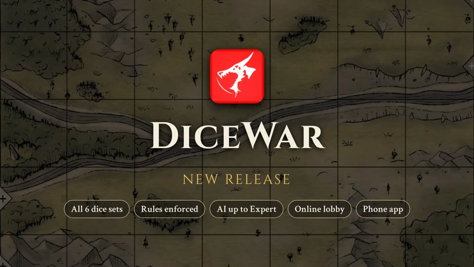

# DiceWar

DiceWar is a dice strategy game for two players. This repository is the free web version: play it in your browser on a PC, tablet or phone.

**▶ Play now: https://frozenstorm.github.io/DiceWar/**

*Click the image to watch the promo video (about 2 minutes, English). The file is also in the repo: [media/DiceWar-promo-en.mp4](media/DiceWar-promo-en.mp4).*

## Features

- **All 6 dice sets:** Light of Dragons (LoD), Rise of Xeladron (RoX), Bond of Demons (BoD), Roots of Mali (RoM), Knights of Steel (KoS) and Dawn of Awakening (DoA).
- **All 6 landscapes:** Craters, Oracle, Ruins, Camp, Knoll and River. A game can use one landscape or any combination of them.
- **Rules are enforced:** every move, attack, upgrade and spell is checked by the rules engine, and only legal fields light up. Rules enforcement can be switched off (*Enforce rules*), and a plain *Numbers* set without rules is available for free play.
- **AI opponent** in four levels: **Easy**, **Medium**, **Hard** and **Expert**. It runs entirely in your browser, and every AI move is animated.
- **Game modes:** Against the AI, Solo (play both sides), Duel (two players on one device, the HUD turns to face the player whose turn it is) and Online.
- **Online lobby:** enter a name, see who is online, challenge a player (dice set, landscapes, who starts, rules on/off). The other player picks their dice set and accepts, and the game starts for both.
- **Undo / Redo** of every action.
- **Save / Load:** save a game to a file and load it later, including the full move history, so Undo / Redo keep working after loading.
- **Rule cards** of both dice sets can be viewed in the game.
- **Responsive PWA:** full screen without scrolling on phone, tablet and laptop. Install it like an app with *Add to Home Screen*; it also works offline (except the online lobby).
- **Radial menu:** tap one of your dice and a ring menu opens around it: Upgrade at the top, Move / Attack at the bottom, spells left and right, and Turn (Knights of Steel) in the centre.

## How to play

1. Pick a game mode: **Against the AI**, **Solo**, **Duel** or **Online**.
2. Pick a dice set for each side, the landscape(s) and the AI level.
3. **Setup:** tap your back row to raise your dice, then **Confirm**.
4. Tap one of your dice and choose an action in the ring menu.
5. Tap a highlighted field. Then it is your opponent's turn.

The full rules are in [`docs/rules/`](docs/rules/).

## Project structure

The site is static (plain HTML and ES modules, no build step) and is hosted on GitHub Pages.

- `index.html` – the game page
- `docs/rules/` – all rules as text: base rules and one file per dice set
- `docs/online.md` – how the online lobby works and how to set up the database rules
- `engine/` – rules engine: `core.js` for the base rules, `sets/<set>.js` per dice set, `locations/` for the landscapes
- `ai/` – AI opponent, runs in a Web Worker (`ui/ai-worker.js`, `ui/expert-worker.js`): `ai.js` (levels Easy / Medium / Hard: minimax with alpha-beta pruning), `expert.js` (level Expert: transposition table, move ordering, late move reductions, quiescence search), `eval.js` (position evaluation), `setup.js` (starting lineups)
- `net/` – online lobby and game sync via Firebase Realtime Database (`online.js`, `backend-firebase.js`, `backend-mock.js` for tests)
- `ui/` – board and HUD: `rules-mode.js` (connects engine and AI to the board), `ring.js` (radial menu), `hud.js`, `animate.js` (animations from the engine event log)
- `sw.js`, `site.webmanifest` – service worker and manifest for the installable app
- `tools/bench.mjs` – developer tool: plays one AI level against another on all CPU cores (`node tools/bench.mjs --a expert --b hard`)
- `media/` – promo video
- `test/` – automated tests

## Development

Run it locally with any static web server, for example `npx serve .` or `python3 -m http.server`, and open the shown address.

- `npm test` – rules engine and AI tests (Node.js 20 or newer, no dependencies)
- `npm run test:online` – online lobby end-to-end test with two browsers against a mock database (needs Playwright: `npm i -D playwright`)

## Credits

- **Original board game DiceWar:** SunCoreGames – https://www.suncoregames.ch/
- **Web game:** Z-Craft – https://www.z-craft.ch/

See [LICENSE.md](LICENSE.md).
